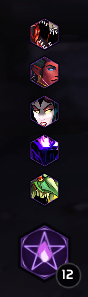
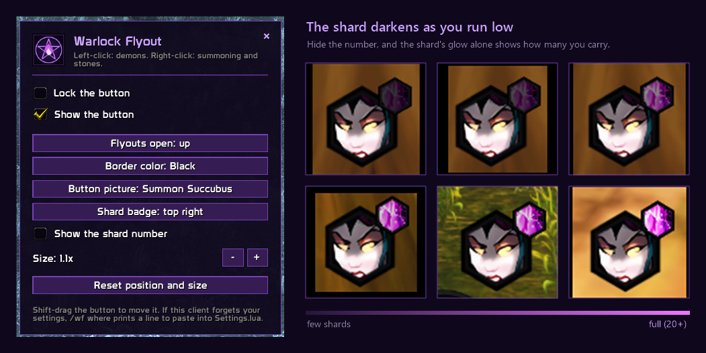
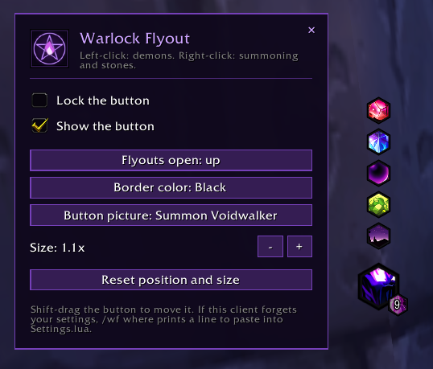

# Warlock Flyout

**One button for your warlock**, made for WoW: Forever.

- **Left-click:** summon any demon you know. Shift-click casts Fel Domination first.
- **Right-click:** Ritual of Summoning, Create Healthstone, Create Soulstone, Create Firestone and Create Spellstone, always your best rank.

Shows only spells you've learned, works in combat, and displays your soul shards.

In `/wf config` you can pick a border color (purple, fel green, ice blue, fire, black and more, or your class color) and a button picture (the pentagram, a Soul Shard or a warlock spell icon). The shard badge can sit in any corner, show or hide its number, and its Soul Shard darkens as you run low. Works on any client language, including German.

## Install

Download it from CurseForge, or copy this repository's files into a folder named
`WarlockFlyout` inside `World of Warcraft\_forever_\Interface\AddOns\`.

## Commands

| Command | What it does |
| --- | --- |
| `/wf config` | Settings window |
| `/lock`, `/unlock` | Fix the button in place, or let it move (also `/wf lock`, `/wf unlock`) |
| `/wf dir up\|down\|left\|right` | Which way the flyouts open |
| `/wf scale 0.5-2` | Button size |
| `/wf show`, `/wf hide` | Show or hide the button |
| `/wf reset` | Back to the middle of the screen |
| `/wf where` | A line to paste into `Settings.lua` if your settings don't stick |
| `/wf spells` | What the flyouts found in your spellbook |

Shift-drag the button to move it while it's unlocked.

## Changes

See [CHANGELOG.md](CHANGELOG.md).

## License

MIT, see [LICENSE](LICENSE).
