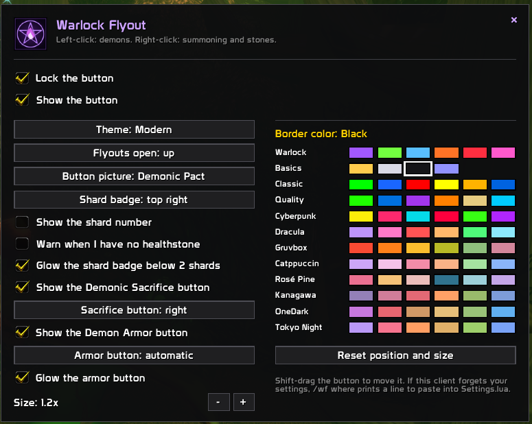
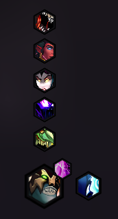
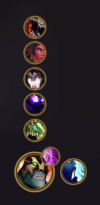
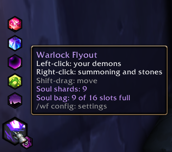

# Warlock Flyout

**WoW: Forever addon:** one button for your warlock.

- **Left-click:** summon any demon you know. Shift-click casts Fel Domination first.
- **Right-click:** Ritual of Summoning, Create Healthstone, Create Soulstone, Create Firestone and Create Spellstone, always your best rank.

Shows only spells you've learned, works in combat, and displays your soul shards.

In `/wf config` you can pick a border color and a button picture (the pentagram, a Soul Shard or a warlock spell icon). The border colors are a menu of swatches: warlock colors (purple, fel green, ice blue, fire, blood red, pink), gold, silver, black, your class color, the game's bar and item quality colors, and the Cyberpunk, Dracula, Gruvbox, Catppuccin, Rosé Pine, Kanagawa, OneDark and Tokyo Night color schemes. The shard badge can sit in any corner, show or hide its number, and its Soul Shard darkens as you run low. Two optional warnings (both off by default): the button pulses green and its border turns green while you have no healthstone, and the shard badge glows in the shards' purple when you're down to 0 or 1 shard. Two themes: **Modern** (the hexagon look) and **Forever** (round gold-ringed buttons and a charcoal and bronze window to match the Forever UI), switched live with the Theme button or `/wf theme`. If you know Demonic Sacrifice, a small extra button appears until you have one of its buffs; you can place it anywhere around the button or turn it off. Works on any client language, including German.

 

## Install

Download it from CurseForge, or copy this repository's files into a folder named
`WarlockFlyout` inside `World of Warcraft\_forever_\Interface\AddOns\`.

## Commands

| Command | What it does |
| --- | --- |
| `/wf config` | Settings window |
| `/lock`, `/unlock` | Fix the button in place, or let it move (also `/wf lock`, `/wf unlock`) |
| `/wf dir up\|down\|left\|right` | Which way the flyouts open |
| `/wf theme modern\|forever` | Switch the look |
| `/wf scale 0.5-2` | Button size |
| `/wf show`, `/wf hide` | Show or hide the button |
| `/wf reset` | Back to the middle of the screen |
| `/wf where` | A line to paste into `Settings.lua` if your settings don't stick |
| `/wf spells` | What the flyouts found in your spellbook |

Shift-drag the button to move it while it's unlocked.

## Changes

See [CHANGELOG.md](CHANGELOG.md).

## License

MIT, see [LICENSE](LICENSE).
